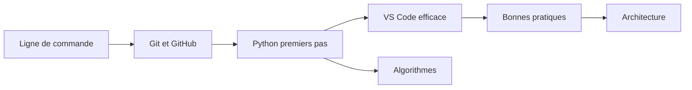

# Tutoriels

Tutoriels en français pour ingénieurs et chefs de projet qui débutent (ou progressent) en développement. Chaque tuto suit la même trame : **objectif**, **prérequis**, **contenu**, **exemples**, **pièges courants**, **pour aller plus loin**.

## Parcours conseillé

## Logiciel — `logiciel/`

| # | Tuto | Ce que vous saurez faire |
|---|------|--------------------------|
| 01 | [Git et GitHub](logiciel/01-git-et-github.md) | Versionner, travailler en branches, ouvrir une PR, résoudre un conflit |
| 02 | [Python : premiers pas](logiciel/02-python-premiers-pas.md) | Installer Python, créer un venv, lire/écrire des fichiers Excel |
| 03 | [Bonnes pratiques de code](logiciel/03-bonnes-pratiques-code.md) | Nommer, découper, tester avec pytest, relire du code |
| 04 | [VS Code efficace](logiciel/04-vscode-efficace.md) | Extensions, raccourcis, débogueur, Git intégré |
| 05 | [Ligne de commande](logiciel/05-ligne-de-commande.md) | Naviguer et automatiser en PowerShell et bash |
| 06 | [Architecture logicielle](logiciel/06-architecture-logicielle.md) | Comprendre couches, API REST, client/serveur, base de données |

## Algorithmes — `algorithmes/`

| # | Tuto | Thème |
|---|------|-------|
| 01 | [Complexité](algorithmes/01-complexite.md) | Notation O, comparer des algorithmes |
| 02 | [Tri et recherche](algorithmes/02-tri-et-recherche.md) | Insertion, fusion, rapide, dichotomie |
| 03 | [Structures de données](algorithmes/03-structures-de-donnees.md) | Liste, pile, file, dictionnaire, ensemble, arbre, tas |
| 04 | [Graphes](algorithmes/04-graphes.md) | BFS, DFS, Dijkstra, chemin critique d'un planning |
| 05 | [Récursivité et programmation dynamique](algorithmes/05-recursivite-et-programmation-dynamique.md) | Fibonacci, sac à dos, plus longue sous-suite commune |
| 06 | [Algorithmes gloutons](algorithmes/06-algorithmes-gloutons.md) | Rendu de monnaie, planification d'activités |
| 07 | [Exercices](algorithmes/07-exercices.md) | 10 exercices progressifs corrigés |

## Intelligence artificielle — `ia/`

- [Sommaire des tutos IA](ia/README.md)

## Unreal Engine — `unreal/`

| # | Tuto | Thème |
|---|------|-------|
| 01 | [Rendu réaliste](unreal/01-rendu-realiste.md) | Exposition, éclairage physique, matériaux PBR, caméra, Lumen vs Path Tracer, export Movie Render Queue |
