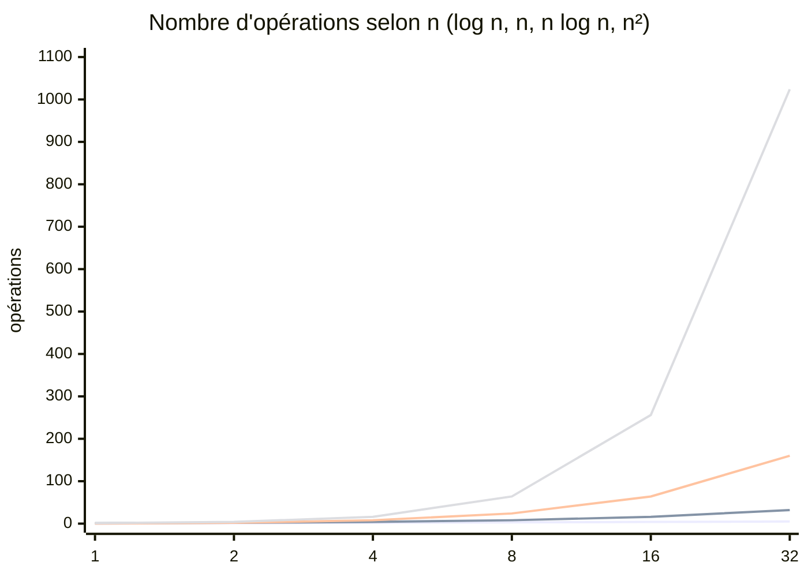

# 01 — Complexité algorithmique

## Objectif

Savoir estimer le coût d'un algorithme (temps et mémoire) avec la **notation O**, pour choisir la bonne approche *avant* que le programme ne devienne lent sur de vraies données.

## Prérequis

- Lire une boucle `for` et une fonction Python.
- Notions de puissances et de logarithme (log₂ 1 000 ≈ 10, log₂ 1 000 000 ≈ 20).

## L'idée

On ne mesure pas des secondes (elles dépendent de la machine) mais **le nombre d'opérations élémentaires en fonction de la taille n des données**. La notation O garde seulement le terme dominant et ignore les constantes : `3n² + 5n + 2` est en **O(n²)**.

On s'intéresse en général au **pire cas** (garantie), parfois au **cas moyen**.

## Les classes à connaître

| Notation | Nom | Exemple typique | n = 1 000 | n = 1 000 000 |
|----------|-----|-----------------|-----------|---------------|
| O(1) | constante | accès `t[i]`, `cle in dico` | 1 | 1 |
| O(log n) | logarithmique | recherche dichotomique | ~10 | ~20 |
| O(n) | linéaire | parcourir une liste, `x in liste` | 1 000 | 10⁶ |
| O(n log n) | quasi-linéaire | `sorted()`, tri fusion | ~10⁴ | ~2·10⁷ |
| O(n²) | quadratique | double boucle, tri insertion | 10⁶ | 10¹² (trop lent) |
| O(2ⁿ) | exponentielle | tester tous les sous-ensembles | ingérable | ingérable |
| O(n!) | factorielle | tester tous les ordres (voyageur de commerce naïf) | ingérable | ingérable |

Ordre de grandeur pratique : Python exécute environ **10⁷ opérations simples par seconde**. 10¹² opérations, c'est plus d'une journée de calcul.



## Lire la complexité dans le code

```python
def total(t):                  # O(n) : une boucle sur n éléments
    s = 0
    for x in t:
        s += x
    return s

def a_des_doublons_naif(t):    # O(n²) : une boucle dans une boucle
    for i in range(len(t)):
        for j in range(i + 1, len(t)):
            if t[i] == t[j]:
                return True
    return False

def a_des_doublons(t):         # O(n) : construire un set coûte O(n)
    return len(set(t)) != len(t)

print(a_des_doublons_naif([1, 2, 3, 2]), a_des_doublons([1, 2, 3]))  # True False
```

Règles simples :

- Des blocs **à la suite** : on additionne, puis on garde le plus gros terme.
- Des boucles **imbriquées** : on multiplie.
- Une boucle qui **divise** n par 2 à chaque tour : O(log n).

## Coût des opérations Python courantes

| Opération | `list` | `dict` / `set` |
|-----------|--------|----------------|
| accès par indice / clé | O(1) | O(1) en moyenne |
| `x in ...` | **O(n)** | **O(1)** en moyenne |
| ajout | `append` O(1), `insert(0, x)` **O(n)** | O(1) en moyenne |
| suppression | `pop()` O(1), `pop(0)` **O(n)** | O(1) en moyenne |
| tri | O(n log n) | — |

## Complexité en mémoire

Même raisonnement pour la mémoire : `a_des_doublons` est plus rapide mais crée un `set` de taille n (O(n) de mémoire en plus). C'est souvent un bon compromis : **on échange de la mémoire contre du temps**.

## Pièges courants

- **`in` sur une liste dans une boucle** : `for x in a: if x in b:` coûte O(n·m). Convertissez `b` en `set` d'abord.
- **`list.pop(0)` pour une file** : O(n) à chaque appel. Utilisez `collections.deque`.
- **Concaténer des chaînes dans une boucle** (`s += morceau`) : préférez `"".join(morceaux)`.
- **Oublier les boucles cachées** : `sorted()`, `max()`, `t.index()`, `t.count()`, `x in liste` parcourent les données.
- **Optimiser trop tôt** : pour n = 100, O(n²) est instantané. Mesurez avant d'optimiser.

## Pour aller plus loin

- Mesurer : `python -m timeit "sorted(range(10000))"` et le profileur `cProfile`.
- La page « TimeComplexity » du wiki Python (coût des opérations sur les types natifs).
- La complexité amortie (pourquoi `append` est O(1) « en moyenne »).
- Suite : [02 — Tri et recherche](02-tri-et-recherche.md).
