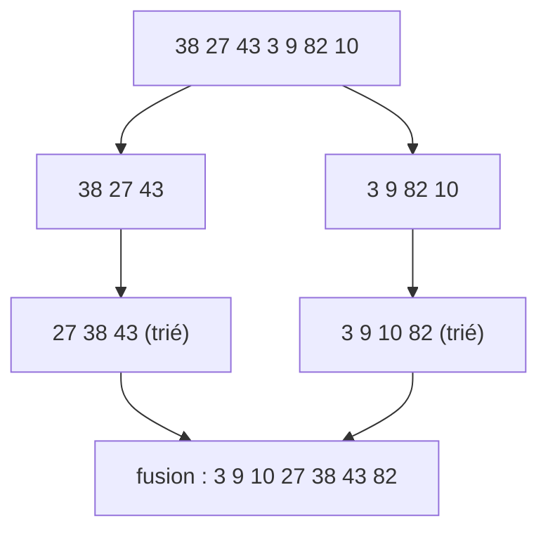

# 02 — Tri et recherche

## Objectif

Comprendre trois algorithmes de tri classiques et la recherche dichotomique, savoir les coder, et surtout savoir **quand utiliser simplement `sorted()`**.

## Prérequis

- [01 — Complexité](01-complexite.md).
- Listes, boucles `while`, notion de fonction récursive.

## Vue d'ensemble

| Algorithme | Meilleur cas | Moyen | Pire cas | Mémoire en plus | Stable (1) |
|------------|--------------|-------|----------|-----------------|------------|
| Tri par insertion | O(n) | O(n²) | O(n²) | O(1) | oui |
| Tri fusion | O(n log n) | O(n log n) | O(n log n) | O(n) | oui |
| Tri rapide (quicksort) | O(n log n) | O(n log n) | O(n²) | O(log n) en place (2) | non |
| `sorted()` / `list.sort()` (Timsort) | O(n) | O(n log n) | O(n log n) | O(n) | oui |

(1) *Stable* : deux éléments égaux gardent leur ordre d'origine (utile pour trier en plusieurs passes).
(2) La version pédagogique ci-dessous crée de nouvelles listes : elle consomme O(n) de mémoire.

## Tri par insertion

Comme on trie des cartes en main : on prend chaque élément et on le glisse à sa place dans la partie déjà triée. Très efficace sur de **petites listes ou des listes presque triées**.

```python
def tri_insertion(t):
    t = list(t)                       # copie : on ne modifie pas l'original
    for i in range(1, len(t)):
        cle = t[i]
        j = i - 1
        while j >= 0 and t[j] > cle:  # décale les plus grands vers la droite
            t[j + 1] = t[j]
            j -= 1
        t[j + 1] = cle
    return t

print(tri_insertion([38, 27, 43, 3, 9, 82, 10]))
# [3, 9, 10, 27, 38, 43, 82]
```

## Tri fusion (diviser pour régner)

On coupe en deux, on trie chaque moitié (récursivement), puis on **fusionne** deux listes triées.



```python
def tri_fusion(t):
    if len(t) <= 1:
        return list(t)
    m = len(t) // 2
    g, d = tri_fusion(t[:m]), tri_fusion(t[m:])
    res, i, j = [], 0, 0
    while i < len(g) and j < len(d):
        if g[i] <= d[j]:              # <= garantit la stabilité
            res.append(g[i]); i += 1
        else:
            res.append(d[j]); j += 1
    res.extend(g[i:])                 # restes éventuels
    res.extend(d[j:])
    return res

print(tri_fusion([38, 27, 43, 3, 9, 82, 10]))
# [3, 9, 10, 27, 38, 43, 82]
```

Complexité : log₂ n niveaux de découpe, chaque niveau coûte O(n) de fusion, soit **O(n log n) garanti**.

## Tri rapide (quicksort)

On choisit un **pivot**, on sépare les plus petits et les plus grands, et on recommence de chaque côté.

```python
def tri_rapide(t):
    if len(t) <= 1:
        return list(t)
    pivot = t[len(t) // 2]
    return (tri_rapide([x for x in t if x < pivot])
            + [x for x in t if x == pivot]
            + tri_rapide([x for x in t if x > pivot]))

print(tri_rapide([38, 27, 43, 3, 9, 82, 10]))
# [3, 9, 10, 27, 38, 43, 82]
```

Le pire cas O(n²) survient quand le pivot est toujours le plus petit ou le plus grand (par exemple : premier élément comme pivot sur une liste déjà triée). Prendre le milieu ou un pivot aléatoire l'évite en pratique.

## Recherche dichotomique

Sur une liste **triée**, on compare à l'élément du milieu et on élimine la moitié à chaque étape : **O(log n)**. Un million d'éléments : environ 20 comparaisons.

```python
def recherche_dicho(t, cible):
    g, d = 0, len(t) - 1
    while g <= d:
        m = (g + d) // 2
        if t[m] == cible:
            return m
        if t[m] < cible:
            g = m + 1
        else:
            d = m - 1
    return -1                         # absent

print(recherche_dicho([3, 9, 10, 27, 38, 43, 82], 27))  # 3
print(recherche_dicho([3, 9, 10], 5))                   # -1
```

En vrai projet, utilisez le module standard `bisect` :

```python
import bisect

t = [3, 9, 10, 27]
print(bisect.bisect_left(t, 27))      # 3
bisect.insort(t, 15)                  # insère en gardant l'ordre
print(t)                              # [3, 9, 10, 15, 27]
```

## En pratique : `sorted` avec `key`

```python
lots = [("Gros oeuvre", 120_000), ("Electricite", 45_000), ("Peinture", 12_000)]
par_montant = sorted(lots, key=lambda lot: lot[1], reverse=True)
print(par_montant[0])                 # ('Gros oeuvre', 120000)
```

## Pièges courants

- **Dichotomie sur une liste non triée** : résultat faux, sans aucune erreur.
- **Boucle infinie** en dichotomie : oublier le `+ 1` / `- 1` sur `g` ou `d`.
- **`t.sort()` renvoie `None`** : `t = t.sort()` remplace votre liste par `None`. Écrivez `t.sort()` seul, ou `t = sorted(t)`.
- **Récursion trop profonde** : Python limite à environ 1000 appels imbriqués ; un quicksort mal pivoté sur une grande liste triée peut lever `RecursionError`.
- **Réécrire un tri en production** : `sorted()` est plus rapide et éprouvé. Codez ces tris pour comprendre, pas pour remplacer.

## Pour aller plus loin

- Tri par tas (heapsort), tri par comptage (O(n + k) pour des entiers bornés).
- Timsort, l'algorithme derrière `sorted()`.
- Les visualisations animées de tris (recherche « sorting algorithms visualization »).
- Suite : [03 — Structures de données](03-structures-de-donnees.md).
