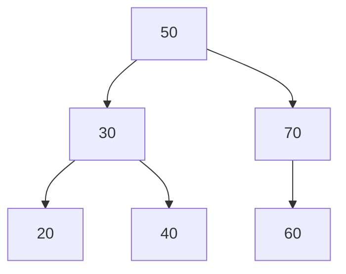
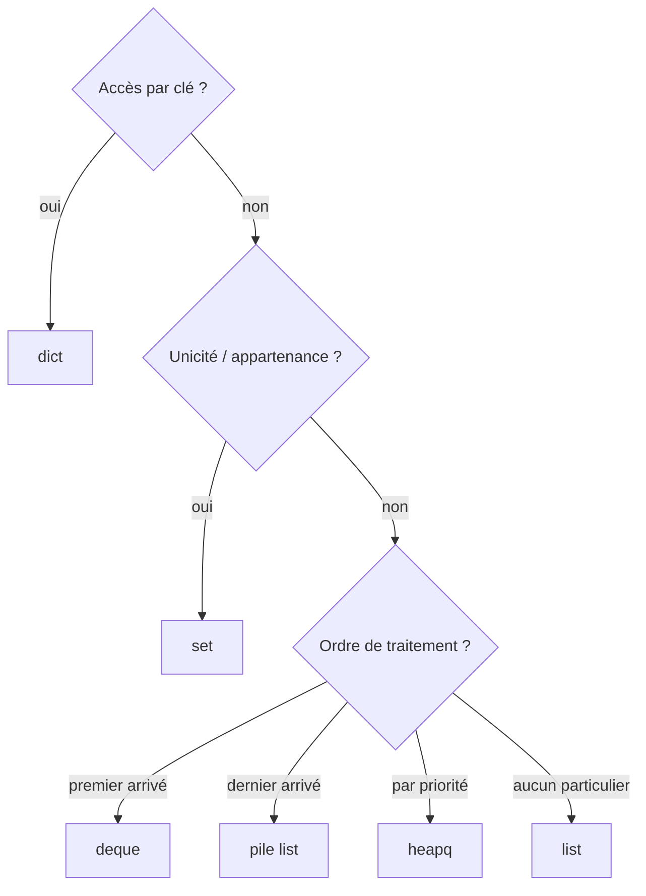

# 03 — Structures de données

## Objectif

Connaître les structures de données essentielles, leur coût, et savoir **laquelle choisir** pour un problème donné.

## Prérequis

- [01 — Complexité](01-complexite.md).
- Bases de Python (listes, dictionnaires, classes simples).

## Liste (`list`)

Tableau dynamique ordonné, accès par indice en O(1).

```python
taches = ["Etudes", "Terrassement"]
taches.append("Fondations")   # O(1)
print(taches[0], len(taches)) # Etudes 3
```

Bon pour : séquence ordonnée, parcours, accès par position. Mauvais pour : recherche (`in` en O(n)), insertion en tête.

## Pile (LIFO : dernier entré, premier sorti)

Une liste Python suffit : `append` pour empiler, `pop` pour dépiler.

```python
def parentheses_ok(s):
    paires = {")": "(", "]": "[", "}": "{"}
    pile = []
    for c in s:
        if c in "([{":
            pile.append(c)
        elif c in paires:
            if not pile or pile.pop() != paires[c]:
                return False
    return not pile

print(parentheses_ok("(a[b]{c})"), parentheses_ok("(]"))  # True False
```

Usages : annuler/rétablir (Ctrl+Z), vérification de syntaxe, parcours en profondeur.

## File (FIFO : premier entré, premier sorti)

Utilisez `collections.deque` (ajout et retrait aux deux bouts en O(1)).

```python
from collections import deque

file = deque()
file.append("demande A")
file.append("demande B")
print(file.popleft())         # demande A
```

Usages : file d'attente de traitements, parcours en largeur (BFS).

## Dictionnaire (`dict`) et table de hachage

Associe une **clé** à une **valeur**. La clé passe dans une fonction de hachage qui donne directement l'emplacement : accès, ajout, test `in` en **O(1) en moyenne**.

```python
budget = {"Acier": 52_000, "Beton": 31_000}
budget["Etudes"] = 18_000
print(budget.get("Grue", 0))  # 0 : valeur par défaut si clé absente

from collections import Counter
print(Counter(["A", "B", "A"]).most_common(1))  # [('A', 2)]
```

Les clés doivent être **hachables** (immuables) : `str`, `int`, `tuple` oui ; `list`, `dict` non.

## Ensemble (`set`)

Un dictionnaire sans valeurs : éléments uniques, test d'appartenance en O(1).

```python
lot_a = {"Dupont", "Martin", "Leroy"}
lot_b = {"Martin", "Petit"}
print(lot_a & lot_b)          # {'Martin'}  intersection
print(sorted(lot_a - lot_b))  # ['Dupont', 'Leroy']  différence
```

## Arbre (exemple : arbre binaire de recherche)

Chaque nœud a au plus deux enfants ; à gauche les valeurs plus petites, à droite les plus grandes. Recherche en O(log n) **si l'arbre est équilibré**, O(n) sinon.



```python
class Noeud:
    def __init__(self, valeur):
        self.valeur, self.gauche, self.droite = valeur, None, None

def inserer(racine, v):
    if racine is None:
        return Noeud(v)
    if v < racine.valeur:
        racine.gauche = inserer(racine.gauche, v)
    else:
        racine.droite = inserer(racine.droite, v)
    return racine

def parcours_infixe(r):       # gauche, nœud, droite -> valeurs triées
    if r is None:
        return []
    return parcours_infixe(r.gauche) + [r.valeur] + parcours_infixe(r.droite)

racine = None
for v in [50, 30, 70, 20, 40, 60]:
    racine = inserer(racine, v)
print(parcours_infixe(racine))  # [20, 30, 40, 50, 60, 70]
```

Les arbres sont partout : arborescence de fichiers, organigramme (WBS d'un projet), index de base de données (B-arbres), DOM d'une page web.

## Tas (`heapq`) et file de priorité

Un tas min donne **le plus petit élément en O(1)** et permet ajout/retrait en O(log n).

```python
import heapq

tas = [5, 1, 8, 3]
heapq.heapify(tas)            # O(n)
print(heapq.heappop(tas), heapq.heappop(tas))  # 1 3

urgences = []
heapq.heappush(urgences, (2, "panne climatisation"))
heapq.heappush(urgences, (1, "fuite de gaz"))
print(heapq.heappop(urgences)[1])  # fuite de gaz (priorité 1 d'abord)
```

Usages : tâches par priorité, Dijkstra, « les k plus grands » (`heapq.nlargest`).

## Quand utiliser quoi ?

| Besoin | Structure | Opération clé |
|--------|-----------|---------------|
| Séquence ordonnée, accès par position | `list` | `t[i]` O(1) |
| Retrouver une info par identifiant | `dict` | `d[cle]` O(1) |
| Éliminer les doublons, tester l'appartenance | `set` | `x in s` O(1) |
| Traiter dans l'ordre d'arrivée | `deque` (file) | `popleft()` O(1) |
| Revenir en arrière, imbrication | `list` (pile) | `pop()` O(1) |
| Toujours prendre le plus prioritaire | `heapq` (tas) | `heappop` O(log n) |
| Hiérarchie, données triées dynamiques | arbre | recherche O(log n) si équilibré |
| Réseau de relations (tâches, routes) | graphe (dict de listes) | voir [04 — Graphes](04-graphes.md) |



## Pièges courants

- **Clé mutable** : `{[1, 2]: "x"}` lève `TypeError: unhashable type: 'list'`. Utilisez un tuple.
- **Ordre d'un `set`** : il n'est pas garanti ; triez avant d'afficher.
- **Modifier un dict pendant qu'on le parcourt** : `RuntimeError`. Parcourez `list(d)` à la place.
- **`heapq` est un tas *min*** : pour un tas max, empilez `-valeur`.
- **Copie superficielle** : `b = a` ne copie pas une liste, les deux noms pointent sur le même objet. Utilisez `a.copy()` ou `copy.deepcopy`.

## Pour aller plus loin

- `collections` : `defaultdict`, `OrderedDict`, `namedtuple` ; `dataclasses` pour des enregistrements propres.
- Arbres équilibrés (AVL, rouge-noir), tries (arbres de préfixes), union-find.
- Suite : [04 — Graphes](04-graphes.md).
