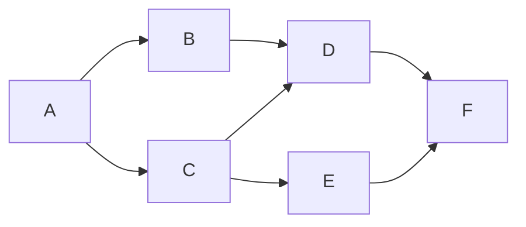
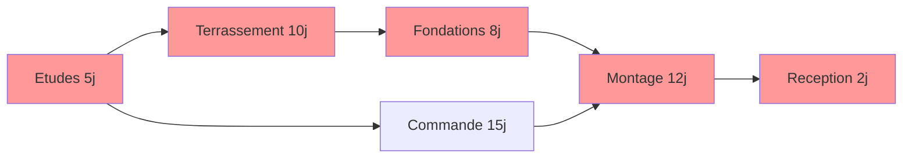

# 04 — Graphes

## Objectif

Représenter un réseau (routes, dépendances de tâches, équipements) sous forme de graphe, le parcourir (BFS, DFS), trouver un plus court chemin (Dijkstra) et calculer le **chemin critique** d'un planning.

## Prérequis

- [03 — Structures de données](03-structures-de-donnees.md) (dict, deque, heapq).
- Notion de récursivité (pour le DFS).

## Vocabulaire

- **Sommet** (nœud) et **arête** (lien). Une arête peut être **orientée** (A → B) et **pondérée** (distance, durée, coût).
- Un graphe orienté **sans cycle** est un **DAG** : c'est le cas d'un planning de tâches.

## Représentation

| Représentation | Mémoire | « A et B sont-ils reliés ? » | Lister les voisins | Quand |
|----------------|---------|------------------------------|--------------------|-------|
| Liste d'adjacence (dict de listes) | O(S + A) | O(degré) | rapide | presque toujours |
| Matrice d'adjacence | O(S²) | O(1) | O(S) | graphe petit et dense |

```python
# Graphe orienté non pondéré : liste d'adjacence
graphe = {
    "A": ["B", "C"],
    "B": ["D"],
    "C": ["D", "E"],
    "D": ["F"],
    "E": ["F"],
    "F": [],
}
```



## Parcours en largeur (BFS)

On explore par « couches » avec une **file**. Le BFS donne le plus court chemin **en nombre d'arêtes**.

```python
from collections import deque

def bfs(g, depart):
    vus = {depart}
    ordre = []
    file = deque([depart])
    while file:
        n = file.popleft()
        ordre.append(n)
        for v in g[n]:
            if v not in vus:
                vus.add(v)
                file.append(v)
    return ordre

print(bfs(graphe, "A"))  # ['A', 'B', 'C', 'D', 'E', 'F']
```

## Parcours en profondeur (DFS)

On va le plus loin possible avant de revenir en arrière (pile implicite de la récursion). Utile pour détecter des cycles, trouver des composantes, faire un tri topologique.

```python
def dfs(g, n, vus=None):
    if vus is None:          # jamais de liste comme valeur par défaut !
        vus = []
    vus.append(n)
    for v in g[n]:
        if v not in vus:
            dfs(g, v, vus)
    return vus

print(dfs(graphe, "A"))  # ['A', 'B', 'D', 'F', 'C', 'E']
```

Complexité des deux parcours : **O(S + A)**. (Ici `vus` est une liste pour garder l'ordre ; sur un gros graphe, ajoutez un `set` pour le test `in`.)

## Plus court chemin pondéré : Dijkstra

Poids **positifs** uniquement. On prend toujours le sommet non traité le plus proche (avec un tas), et on « relâche » ses voisins.

```python
import heapq

def dijkstra(g, depart):
    dist = {n: float("inf") for n in g}
    dist[depart] = 0
    pred = {}
    tas = [(0, depart)]
    while tas:
        d, n = heapq.heappop(tas)
        if d > dist[n]:
            continue                       # entrée périmée
        for v, poids in g[n].items():
            if d + poids < dist[v]:
                dist[v] = d + poids
                pred[v] = n
                heapq.heappush(tas, (dist[v], v))
    return dist, pred

routes = {  # distances en km (valeurs d'exemple)
    "Lyon": {"Grenoble": 110, "Valence": 100},
    "Grenoble": {"Valence": 95, "Chambery": 60},
    "Valence": {"Avignon": 125},
    "Chambery": {"Avignon": 280},
    "Avignon": {},
}
dist, pred = dijkstra(routes, "Lyon")
print(dist["Avignon"])  # 225

chemin = ["Avignon"]
while chemin[-1] != "Lyon":
    chemin.append(pred[chemin[-1]])
print(chemin[::-1])     # ['Lyon', 'Valence', 'Avignon']
```

Complexité : **O((S + A) log S)**.

## Application : planning et chemin critique

Un planning est un DAG : sommets = tâches (avec une durée), arêtes = « doit finir avant ». On cherche :

- la **date de début au plus tôt** de chaque tâche ;
- la **durée totale** du projet ;
- la **marge** de chaque tâche (retard possible sans décaler la fin). Les tâches à marge nulle forment le **chemin critique**.



Méthode : tri topologique (algorithme de Kahn), passe avant (au plus tôt), passe arrière (au plus tard).

```python
from collections import deque

def chemin_critique(taches):
    """taches : {nom: (duree, [predecesseurs])}"""
    succ = {t: [] for t in taches}
    nb_preds = {t: len(p) for t, (_, p) in taches.items()}
    for t, (_, preds) in taches.items():
        for p in preds:
            succ[p].append(t)

    # 1. Tri topologique (Kahn)
    file = deque(t for t in taches if nb_preds[t] == 0)
    ordre = []
    while file:
        t = file.popleft()
        ordre.append(t)
        for s in succ[t]:
            nb_preds[s] -= 1
            if nb_preds[s] == 0:
                file.append(s)
    if len(ordre) != len(taches):
        raise ValueError("Le planning contient un cycle")

    # 2. Passe avant : début au plus tôt
    debut_tot = {}
    for t in ordre:
        debut_tot[t] = max((debut_tot[p] + taches[p][0] for p in taches[t][1]), default=0)
    fin_projet = max(debut_tot[t] + taches[t][0] for t in taches)

    # 3. Passe arrière : fin au plus tard
    fin_tard = {}
    for t in reversed(ordre):
        fin_tard[t] = min((fin_tard[s] - taches[s][0] for s in succ[t]), default=fin_projet)

    marge = {t: fin_tard[t] - taches[t][0] - debut_tot[t] for t in taches}
    return fin_projet, debut_tot, marge

projet = {
    "Etudes": (5, []),
    "Terrassement": (10, ["Etudes"]),
    "Commande": (15, ["Etudes"]),
    "Fondations": (8, ["Terrassement"]),
    "Montage": (12, ["Fondations", "Commande"]),
    "Reception": (2, ["Montage"]),
}
fin, debut_tot, marge = chemin_critique(projet)
print(fin)                                  # 37
print(marge["Commande"])                    # 3
print([t for t in marge if marge[t] == 0])
# ['Etudes', 'Terrassement', 'Fondations', 'Montage', 'Reception']
```

Lecture : le projet dure 37 jours ; la commande peut glisser de 3 jours sans retarder la fin ; toute autre tâche en retard retarde le projet.

## Pièges courants

- **Dijkstra avec des poids négatifs** : résultat faux. Utilisez Bellman-Ford.
- **Oublier l'ensemble `vus`** : boucle infinie dès qu'il y a un cycle.
- **Graphe non orienté** : ajoutez l'arête dans les deux sens (`g[a].append(b)` et `g[b].append(a)`).
- **Sommet absent des clés** : un sommet sans successeur doit quand même figurer (`"F": []`), sinon `KeyError`.
- **Cycle dans un planning** : le tri topologique ne peut pas tout ordonner ; c'est une erreur de saisie à signaler.

## Pour aller plus loin

- Bibliothèque `networkx` (`nx.dijkstra_path`, `nx.dag_longest_path`, `nx.topological_sort`).
- A* (Dijkstra guidé par une heuristique), Bellman-Ford, Floyd-Warshall.
- Arbres couvrants minimaux (Kruskal, Prim) : voir [06 — Gloutons](06-algorithmes-gloutons.md).
- Méthode PERT et diagramme de Gantt en gestion de projet.
- Suite : [05 — Récursivité et programmation dynamique](05-recursivite-et-programmation-dynamique.md).
