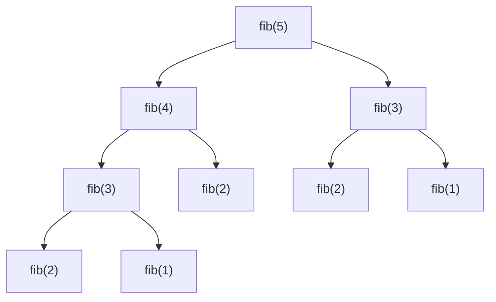

# 05 — Récursivité et programmation dynamique

## Objectif

Écrire des fonctions récursives correctes, comprendre pourquoi certaines explosent en temps, et les accélérer par **mémoïsation** ou **programmation dynamique** (PD).

## Prérequis

- Fonctions Python, listes à deux dimensions.
- [01 — Complexité](01-complexite.md).

## La récursivité

Une fonction récursive s'appelle elle-même sur un problème plus petit. Deux ingrédients obligatoires :

1. un **cas de base** qui s'arrête ;
2. un **appel récursif** qui se rapproche du cas de base.

```python
def factorielle(n):
    if n <= 1:                    # cas de base
        return 1
    return n * factorielle(n - 1) # appel sur un problème plus petit

print(factorielle(5))  # 120
```

## Fibonacci : naïf, mémoïsé, itératif

`F(0) = 0, F(1) = 1, F(n) = F(n-1) + F(n-2)`.

```python
def fib_naif(n):                  # O(2^n) : recalcule sans cesse les mêmes valeurs
    return n if n < 2 else fib_naif(n - 1) + fib_naif(n - 2)

print(fib_naif(10))  # 55   (fib_naif(40) prend déjà plusieurs secondes)
```



`fib(3)` est calculé deux fois, `fib(2)` trois fois... La **mémoïsation** stocke chaque résultat la première fois :

```python
from functools import lru_cache

@lru_cache(maxsize=None)          # cache automatique des résultats
def fib(n):
    return n if n < 2 else fib(n - 1) + fib(n - 2)

print(fib(80))  # 23416728348467685  -> instantané, O(n)
```

Version itérative (*bottom-up*), sans risque de dépasser la limite de récursion :

```python
def fib_iter(n):
    a, b = 0, 1
    for _ in range(n):
        a, b = b, a + b
    return a

print(fib_iter(80))  # 23416728348467685
```

## La programmation dynamique

La PD s'applique quand un problème a :

- des **sous-problèmes qui se répètent** ;
- une **sous-structure optimale** : la solution optimale se construit à partir des solutions optimales des sous-problèmes.

Démarche : (1) définir ce que représente une case du tableau, (2) écrire la relation de récurrence, (3) remplir le tableau dans le bon ordre, (4) remonter le tableau pour retrouver la solution.

## Sac à dos 0/1

Des objets ont un poids et une valeur ; capacité limitée ; chaque objet est pris ou non. Cas concret : choisir des projets (coût, gain) sous contrainte de budget.

`T[i][c]` = meilleure valeur avec les `i` premiers objets et une capacité `c` :
`T[i][c] = max(T[i-1][c], T[i-1][c - poids_i] + valeur_i)` si l'objet tient.

```python
def sac_a_dos(objets, capacite):
    """objets : liste de (nom, poids, valeur). Renvoie (valeur max, noms choisis)."""
    n = len(objets)
    T = [[0] * (capacite + 1) for _ in range(n + 1)]
    for i in range(1, n + 1):
        nom, poids, valeur = objets[i - 1]
        for c in range(capacite + 1):
            T[i][c] = T[i - 1][c]                       # on ne prend pas l'objet
            if poids <= c:
                T[i][c] = max(T[i][c], T[i - 1][c - poids] + valeur)
    # Remontée pour retrouver les objets choisis
    choix, c = [], capacite
    for i in range(n, 0, -1):
        if T[i][c] != T[i - 1][c]:
            choix.append(objets[i - 1][0])
            c -= objets[i - 1][1]
    return T[n][capacite], choix[::-1]

objets = [("A", 1, 1), ("B", 3, 4), ("C", 4, 5), ("D", 5, 7)]
print(sac_a_dos(objets, 7))  # (9, ['B', 'C'])
```

Complexité : **O(n × capacité)** au lieu de O(2ⁿ) en testant toutes les combinaisons. Remarque : l'approche gloutonne « meilleur ratio valeur/poids d'abord » prendrait D puis A (valeur 8) : elle n'est pas optimale ici.

## Plus longue sous-suite commune (PLSC / LCS)

Sous-suite = lettres dans le même ordre, pas forcément contiguës. C'est le principe des outils de comparaison de fichiers (`diff`, comparaison de versions dans Git).

`T[i][j]` = longueur de la PLSC entre les `i` premiers caractères de `a` et les `j` premiers de `b`.

```python
def plsc(a, b):
    n, m = len(a), len(b)
    T = [[0] * (m + 1) for _ in range(n + 1)]
    for i in range(1, n + 1):
        for j in range(1, m + 1):
            if a[i - 1] == b[j - 1]:
                T[i][j] = T[i - 1][j - 1] + 1
            else:
                T[i][j] = max(T[i - 1][j], T[i][j - 1])
    # Remontée
    res, i, j = [], n, m
    while i > 0 and j > 0:
        if a[i - 1] == b[j - 1]:
            res.append(a[i - 1]); i -= 1; j -= 1
        elif T[i - 1][j] >= T[i][j - 1]:
            i -= 1
        else:
            j -= 1
    return "".join(reversed(res))

print(plsc("ABCBDAB", "BDCABA"))  # BCBA (longueur 4 ; d'autres solutions de même longueur existent)
```

Complexité : **O(n × m)** en temps et en mémoire.

## Pièges courants

- **Pas de cas de base** (ou jamais atteint) : `RecursionError: maximum recursion depth exceeded`.
- **Limite de récursion** (~1000) : passez à une version itérative plutôt que de pousser `sys.setrecursionlimit`.
- **`lru_cache` avec des arguments non hachables** (liste, dict) : `TypeError`. Passez des tuples.
- **Décalage d'indice** dans les tableaux de PD : la ligne/colonne 0 représente « aucun élément », d'où les `i - 1`.
- **Copier une ligne avec `[[0] * m] * n`** : les n lignes sont le même objet ! Utilisez une compréhension de liste.

## Pour aller plus loin

- Distance d'édition (Levenshtein), rendu de monnaie optimal (exercice 10 de [07 — Exercices](07-exercices.md)).
- Réduire la mémoire : ne garder que la ligne précédente du tableau.
- Module `difflib` de la bibliothèque standard.
- Suite : [06 — Algorithmes gloutons](06-algorithmes-gloutons.md).
