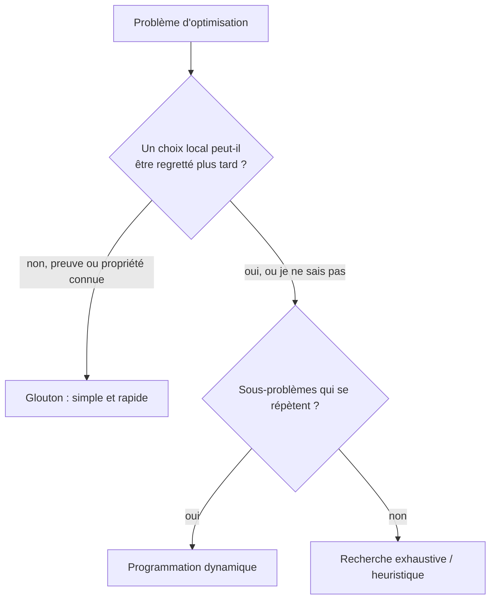

# 06 — Algorithmes gloutons

## Objectif

Comprendre la stratégie gloutonne (« faire le meilleur choix local à chaque étape »), savoir l'appliquer, et surtout savoir **quand elle donne la solution optimale et quand elle échoue**.

## Prérequis

- Tri avec `sorted(..., key=...)` ([02 — Tri et recherche](02-tri-et-recherche.md)).
- Utile : [05 — Programmation dynamique](05-recursivite-et-programmation-dynamique.md) pour comparer.

## Le principe

1. Trier ou ordonner les candidats selon un critère.
2. Prendre le meilleur candidat compatible, sans jamais revenir en arrière.
3. Recommencer jusqu'à épuisement.

Avantages : simple et rapide (souvent O(n log n) à cause du tri). Inconvénient : **pas toujours optimal**. Il faut une justification (preuve ou contre-exemple) avant de lui faire confiance.

| Problème | Glouton optimal ? |
|----------|-------------------|
| Rendu de monnaie en euros | oui (système « canonique ») |
| Rendu de monnaie avec pièces quelconques | **non** |
| Sélection d'activités (max de réunions dans une salle) | oui, en triant par heure de **fin** |
| Sac à dos fractionnaire (on peut couper les objets) | oui |
| Sac à dos 0/1 | **non** (utiliser la PD) |
| Arbre couvrant minimal (Kruskal, Prim) | oui |
| Plus court chemin (Dijkstra, poids positifs) | oui |

## Rendu de monnaie

Valeurs en centimes pour éviter les erreurs d'arrondi des nombres à virgule.

```python
def rendu(montant, pieces=(200, 100, 50, 20, 10, 5, 2, 1)):
    res = {}
    for p in pieces:                      # pièces triées de la plus grande à la plus petite
        if montant >= p:
            res[p], montant = divmod(montant, p)
    return res

print(rendu(289))  # {200: 1, 50: 1, 20: 1, 10: 1, 5: 1, 2: 2}
```

Contre-exemple avec un système non canonique :

```python
print(rendu(6, (4, 3, 1)))  # {4: 1, 1: 2} -> 3 pièces, alors que 3 + 3 n'en fait que 2
```

## Sélection d'activités (planning d'une salle)

On veut placer le **maximum** de réunions sans chevauchement. Le bon critère : **terminer le plus tôt possible** pour laisser la place aux suivantes.

```python
def activites(reunions):
    """reunions : liste de (nom, debut, fin)."""
    choisies, fin_courante = [], float("-inf")
    for nom, debut, fin in sorted(reunions, key=lambda r: r[2]):  # tri par fin
        if debut >= fin_courante:
            choisies.append(nom)
            fin_courante = fin
    return choisies

reunions = [("R1", 9, 10), ("R2", 9, 12), ("R3", 10, 11),
            ("R4", 11, 13), ("R5", 12, 14), ("R6", 13, 15)]
print(activites(reunions))  # ['R1', 'R3', 'R4', 'R6']
```

Trier par heure de *début* ou par *durée* ne garantit pas l'optimum (essayez de trouver un contre-exemple).

## Sac à dos fractionnaire

Si l'on peut prendre une fraction d'objet (vrac, heures de sous-traitance...), prendre d'abord le meilleur **ratio valeur/poids** est optimal.

```python
def sac_fractionnaire(objets, capacite):
    total = 0.0
    for nom, poids, valeur in sorted(objets, key=lambda o: o[2] / o[1], reverse=True):
        pris = min(poids, capacite)
        total += valeur * pris / poids
        capacite -= pris
        if capacite == 0:
            break
    return total

print(sac_fractionnaire([("A", 10, 60), ("B", 20, 100), ("C", 30, 120)], 50))  # 240.0
```

## Glouton ou programmation dynamique ?



## Pièges courants

- **Croire le glouton optimal sans le vérifier** : testez-le contre une recherche exhaustive sur de petits cas.
- **Mauvais critère de tri** : pour les activités, la fin et non le début.
- **Montants en `float`** : `0.1 + 0.2 != 0.3`. Travaillez en centimes (entiers) ou avec `decimal.Decimal`.
- **Égalités** : précisez le comportement quand deux candidats ont le même critère (`debut >= fin_courante` autorise deux réunions bout à bout).

## Pour aller plus loin

- Kruskal (avec union-find) et Prim pour relier des sites au moindre coût de câble.
- Codage de Huffman (compression).
- Heuristiques gloutonnes pour problèmes difficiles (ordonnancement d'ateliers, tournées) : bonnes solutions rapides, sans garantie d'optimum.
- Suite : [07 — Exercices](07-exercices.md).
