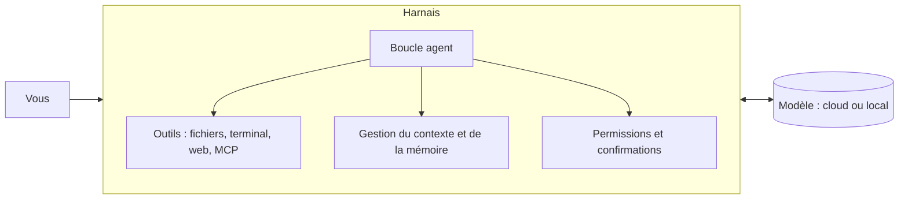

# 10 — Harnais et outils IA open source

## Objectif

Comprendre ce qu'est un **harnais** (*harness*) d'agent IA, connaître les principaux harnais et
outils **open source**, et savoir lire leurs licences pour les utiliser en entreprise en toute
légalité.

**Prérequis** : [04 — Coder avec un assistant IA](04-coder-avec-un-assistant-ia.md),
[09 — MCP](09-mcp-model-context-protocol.md).

## 1. Qu'est-ce qu'un harnais ?

Un modèle de langage ne fait que produire du texte. Le **harnais** est le programme qui
l'entoure et le transforme en **agent** capable de travailler :

| Fonction du harnais | Exemple |
|---|---|
| **Boucle agent** | Le modèle propose une action, le harnais l'exécute, renvoie le résultat, et recommence jusqu'à ce que la tâche soit finie. |
| **Outils** | Lire et modifier des fichiers, lancer des commandes, chercher dans le code, appeler des serveurs MCP. |
| **Contexte** | Choisir quels fichiers montrer au modèle, résumer l'historique quand il devient trop long. |
| **Permissions** | Demander confirmation avant une commande ou une modification. |
| **Instructions projet** | Lire un fichier type `AGENTS.md` ou `CLAUDE.md` à la racine du dépôt. |

Le même modèle peut donner des résultats très différents selon le harnais : la qualité des
outils, du contexte et des garde-fous compte autant que le modèle lui-même.

## 2. « Libre de droit », « open source », « open weights » : ne pas confondre

| Terme | Ce que ça veut dire | Ce que ça ne veut PAS dire |
|---|---|---|
| **Libre de droit** | Expression courante mais juridiquement floue. Rien n'est « sans droits » : tout logiciel a un auteur et une licence. | Qu'on peut tout faire sans condition. |
| **Open source** | Le code est publié sous une licence qui autorise l'usage, la modification et la redistribution (définition de l'OSI). | Que le service associé est gratuit, ni que le modèle utilisé est libre. |
| **Open weights** | Les poids d'un modèle sont téléchargeables. | Que la licence est open source : certaines limitent l'usage commercial, la taille de l'entreprise ou certains domaines. |

### Les licences les plus courantes

| Licence | Usage commercial | Obligations principales |
|---|---|---|
| **MIT** | Oui | Garder la mention de copyright et la licence. |
| **Apache 2.0** | Oui | Garder les mentions, signaler les modifications. Inclut une protection sur les brevets. |
| **BSD** | Oui | Garder les mentions. |
| **GPL v3** | Oui | Si vous **distribuez** un logiciel dérivé, il doit être publié sous GPL avec son code. |
| **AGPL v3** | Oui | Comme la GPL, mais aussi si le logiciel est **utilisé via un réseau** (service en ligne). |
| **Licences de modèles « maison »** | Variable | Lire les conditions : seuils d'utilisateurs, usages interdits, obligation de citer. |

> **MIT et Apache 2.0** sont les plus simples pour un usage en entreprise. Pour GPL/AGPL et les
> licences de modèles spécifiques, faites valider par votre service juridique.

## 3. Harnais d'agents de code open source

Panorama en 2026. Les projets évoluent vite : **vérifiez la licence dans le fichier `LICENSE` du
dépôt** avant tout usage, elle peut changer d'une version à l'autre.

| Outil | Type | Licence (à vérifier) | Points forts |
|---|---|---|---|
| **Aider** | Terminal | Apache 2.0 | Pionnier, très intégré à Git (commit automatique de chaque modification), fonctionne avec de nombreux modèles. |
| **OpenHands** | Agent autonome (web / terminal) | MIT | Agent qui travaille dans un environnement isolé (conteneur), adapté aux tâches longues. |
| **Cline** | Extension VS Code | Apache 2.0 | Agent dans l'éditeur, validation pas à pas, support MCP. |
| **Roo Code** | Extension VS Code | Apache 2.0 | Dérivé de Cline, avec des « modes » (architecte, code, débogage…). |
| **Continue** | Extension VS Code / JetBrains | Apache 2.0 | Assistant configurable, modèles cloud ou locaux. |
| **goose** | Terminal et application de bureau | Apache 2.0 | Agent généraliste extensible par MCP, projet confié à une fondation. |
| **opencode** | Terminal | MIT | Interface terminal soignée, multi-fournisseurs. |
| **Codex CLI** (OpenAI) | Terminal | Apache 2.0 | Client open source, conçu d'abord pour les modèles OpenAI. |
| **Gemini CLI** (Google) | Terminal | Apache 2.0 | Client open source, conçu d'abord pour les modèles Gemini. |

> **Client open source ≠ usage gratuit** : la plupart de ces outils appellent un modèle via une
> API payante. Le harnais est libre, la consommation du modèle se paie (sauf modèle local).
>
> À l'inverse, certains assistants très utilisés (par exemple Claude Code, GitHub Copilot ou
> Cursor) ne sont **pas** open source : ils restent utilisables en entreprise, mais selon les
> conditions de leur éditeur.

## 4. Frameworks pour construire ses propres agents

Pour développer un agent sur mesure (automatiser un processus interne, par exemple) :

| Framework | Langage | Licence (à vérifier) | Usage |
|---|---|---|---|
| **SDK MCP officiels** | Python, TypeScript, etc. | MIT | Écrire des serveurs et clients MCP. |
| **LangGraph** | Python, JS | MIT | Agents sous forme de graphes d'états, avec reprise et validation humaine. |
| **LlamaIndex** | Python, TS | MIT | Agents sur vos documents (RAG). |
| **smolagents** (Hugging Face) | Python | Apache 2.0 | Agents minimalistes, faciles à lire et à modifier. |
| **CrewAI** | Python | MIT | Plusieurs agents avec des rôles qui collaborent. |
| **AutoGen** (Microsoft) | Python, .NET | MIT (code) | Conversations multi-agents. |

Commencez simple : une boucle « modèle + 2 ou 3 outils » bien testée vaut mieux qu'un
framework multi-agents complexe.

## 5. Faire tourner des modèles en local

Pour garder les données **sur votre machine** (confidentialité) ou travailler sans connexion :

| Outil | Licence (à vérifier) | Rôle |
|---|---|---|
| **Ollama** | MIT | Télécharger et lancer des modèles en une commande ; expose une API locale. |
| **llama.cpp** | MIT | Moteur d'inférence léger, base de nombreux outils. |
| **vLLM** | Apache 2.0 | Serveur haute performance pour une équipe (GPU). |
| **LM Studio** | Propriétaire (gratuit) | Interface graphique simple. Pratique, mais pas open source. |

La plupart des harnais du tableau 3 peuvent se brancher sur ces serveurs locaux.

**Familles de modèles à poids ouverts** souvent utilisées en 2026 : Qwen, Mistral, DeepSeek,
Gemma, Llama, gpt-oss… Les licences vont d'Apache 2.0/MIT à des licences spécifiques avec
restrictions : **lisez la licence de chaque modèle**, pas seulement celle de l'outil qui le lance.

### Limites du local

- Un bon agent de code demande un modèle puissant, donc une carte graphique avec beaucoup de
  mémoire (24 Go de VRAM et plus pour un confort réel).
- Les modèles locaux restent en général en dessous des meilleurs modèles cloud pour les tâches
  longues et complexes.
- Bon compromis : modèle local pour les données sensibles et les tâches simples, modèle cloud
  (avec un accord de confidentialité adapté) pour le reste.

## 6. Choisir

| Votre besoin | Piste |
|---|---|
| Coder dans VS Code avec validation de chaque étape | Cline, Roo Code ou Continue |
| Travailler en terminal avec Git comme filet | Aider ou opencode |
| Confier une tâche longue à un agent isolé | OpenHands |
| Agent généraliste branché sur vos outils (MCP) | goose |
| Données qui ne doivent pas sortir | Harnais + Ollama ou vLLM avec un modèle local |
| Automatiser un processus métier | LangGraph ou smolagents + serveurs MCP maison |

## 7. Pièges courants

- Croire qu'« open source » veut dire « libre de toute contrainte » : les licences ont des
  obligations, surtout GPL et AGPL.
- Vérifier la licence de l'outil mais pas celle du **modèle**.
- Installer une extension ou un serveur depuis une source non officielle (risque de logiciel
  malveillant).
- Laisser un agent exécuter des commandes sans confirmation sur une machine contenant des
  secrets.
- Oublier les coûts d'API : un agent autonome peut consommer beaucoup de tokens. Fixez une
  limite de dépense chez le fournisseur.

## Checklist

- [ ] J'ai lu le fichier `LICENSE` de l'outil **et** la licence du modèle.
- [ ] La licence est compatible avec mon usage (interne, commercial, service en ligne).
- [ ] L'outil vient du dépôt officiel du projet.
- [ ] Les permissions sont réglées (confirmation avant commande ou écriture).
- [ ] Les secrets sont hors de portée de l'agent (variables d'environnement, pas dans le dépôt).
- [ ] Une limite de dépense est fixée si j'utilise une API payante.
- [ ] La politique IA de mon organisation autorise cet outil et ce fournisseur de modèle.

## Pour aller plus loin

- La définition officielle de l'open source : *opensource.org/osd*.
- Le site *choosealicense.com* pour comprendre les licences en une page.
- [06 — Sécurité, confidentialité et éthique](06-securite-confidentialite-et-ethique.md).
