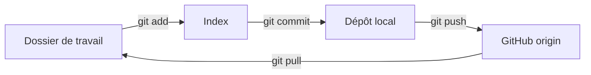
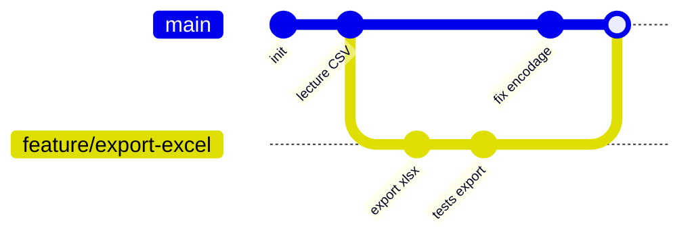

# 01 — Git et GitHub

## Objectif

Versionner son travail avec Git, collaborer sur GitHub (branches, pull requests), résoudre un conflit sans paniquer, et éviter les erreurs classiques (secrets publiés, commits illisibles).

## Prérequis

- Git installé : `git --version` doit répondre (sinon : https://git-scm.com).
- Un compte GitHub.
- Savoir ouvrir un terminal ([05 — Ligne de commande](05-ligne-de-commande.md)).

## Les concepts

**Git** est un logiciel local qui enregistre l'historique d'un dossier. **GitHub** est un site qui héberge des dépôts Git et ajoute la collaboration (PR, revues, tickets).

| Terme | Signification |
|-------|---------------|
| Dépôt (*repository*) | Dossier suivi par Git (contient un sous-dossier caché `.git`) |
| Commit | Photo de l'état des fichiers, avec un message, un auteur et un identifiant (hash) |
| Branche | Ligne de travail parallèle ; `main` est la branche principale |
| Zone d'index (*staging*) | Sas où l'on prépare le prochain commit (`git add`) |
| Remote (`origin`) | Copie distante du dépôt (sur GitHub) |
| Pull request (PR) | Demande de fusion d'une branche, avec discussion et revue |



## Configuration initiale (une seule fois)

```bash
git config --global user.name "Prénom Nom"
git config --global user.email "vous@exemple.com"
git config --global init.defaultBranch main
git config --global core.autocrlf true     # Windows : gère les fins de ligne
```

## Les commandes du quotidien

```bash
git clone https://github.com/compte/projet.git   # récupérer un dépôt
cd projet
git status                    # LA commande à taper tout le temps
git pull                      # récupérer les changements des collègues
# ... modifier des fichiers ...
git diff                      # voir ce qui a changé
git add rapport.py            # préparer un fichier (ou git add . pour tout)
git commit -m "Ajoute le calcul des marges"
git push                      # envoyer sur GitHub
git log --oneline --graph     # historique compact
```

Annuler (sans danger) :

| Situation | Commande |
|-----------|----------|
| Jeter les modifs d'un fichier non indexé | `git restore fichier.py` |
| Retirer un fichier de l'index | `git restore --staged fichier.py` |
| Corriger le message du dernier commit (pas encore poussé) | `git commit --amend` |
| Annuler un commit déjà poussé | `git revert <hash>` (crée un commit inverse) |

## Branches

Une branche par sujet (fonctionnalité, correction). `main` reste toujours propre.

```bash
git switch -c feature/export-excel   # créer et aller sur une branche
# ... commits ...
git push -u origin feature/export-excel
git switch main                      # revenir sur main
git branch                           # lister les branches
git branch -d feature/export-excel   # supprimer une branche fusionnée
```



## Pull request (PR)

1. Poussez votre branche (`git push -u origin ma-branche`).
2. Sur GitHub, bouton **Compare & pull request**.
3. Titre clair, description : *quoi*, *pourquoi*, *comment tester*.
4. Demandez une revue (*Reviewers*), répondez aux commentaires par de nouveaux commits sur la même branche.
5. Une fois approuvée : **Merge**, puis supprimez la branche.

Avec l'outil en ligne de commande GitHub (`gh`) : `gh pr create --fill`.

## Résoudre un conflit

Un conflit arrive quand deux branches modifient **les mêmes lignes**. Git ne choisit pas à votre place :

```bash
git switch feature/export-excel
git merge main
# CONFLICT (content): Merge conflict in config.py
```

Le fichier contient alors des marqueurs :

```text
<<<<<<< HEAD
TAUX_TVA = 0.20
=======
TAUX_TVA = 0.055
>>>>>>> main
```

- Entre `<<<<<<< HEAD` et `=======` : votre version.
- Entre `=======` et `>>>>>>> main` : l'autre version.

Procédure :

1. Éditez le fichier pour garder la bonne version (ou un mélange) et **supprimez les trois marqueurs**.
2. `git add config.py`
3. `git commit` (le message de fusion est pré-rempli).
4. En cas de doute : `git merge --abort` remet tout comme avant.

VS Code affiche des boutons *Accept Current / Accept Incoming / Accept Both* au-dessus de chaque conflit ([04 — VS Code](04-vscode-efficace.md)).

## Bonnes pratiques de commit

- **Petits commits**, un sujet par commit.
- Message à l'**impératif**, court (≤ 50 caractères), qui dit *quoi* ; le corps (après une ligne vide) dit *pourquoi*.
- Convention optionnelle *Conventional Commits* : `feat:`, `fix:`, `docs:`, `refactor:`, `test:`.

| Mauvais | Bon |
|---------|-----|
| `modifs` | `fix: corrige l'arrondi des montants TTC` |
| `wip` | `feat: ajoute l'export Excel du planning` |
| `update fichier.py` | `refactor: extrait la lecture CSV dans lecture.py` |

## Le fichier `.gitignore`

Liste des fichiers que Git doit ignorer. À créer **dès le début** à la racine du dépôt :

```gitignore
# Environnements et caches Python
.venv/
__pycache__/
*.pyc
.pytest_cache/

# Secrets : ne JAMAIS les versionner
.env
*.key

# Fichiers d'éditeur et système
.vscode/settings.json
.DS_Store
Thumbs.db

# Données volumineuses ou temporaires
*.log
~$*.xlsx
```

Attention : `.gitignore` n'agit pas sur un fichier **déjà suivi**. Il faut d'abord `git rm --cached fichier`.

## Authentification et tokens

GitHub n'accepte plus le mot de passe du compte pour `git push` en HTTPS. Options :

1. **Git Credential Manager** (installé avec Git pour Windows) : au premier `push`, une fenêtre de connexion s'ouvre, puis c'est mémorisé. Le plus simple.
2. **Personal Access Token (PAT)** : GitHub > *Settings* > *Developer settings* > *Personal access tokens* > *Fine-grained tokens*. Limitez-le à un dépôt, aux droits nécessaires, avec une date d'expiration. On le colle à la place du mot de passe.
3. **Clé SSH** : `ssh-keygen -t ed25519`, puis ajout de la clé publique (`.pub`) dans *Settings* > *SSH and GPG keys*.

Règles d'or :

- Un token est un mot de passe : **jamais** dans le code, un commit, un ticket ou un message.
- Stockez les secrets dans un fichier `.env` ignoré par Git, ou dans les *Secrets* GitHub Actions.
- Si un secret a été poussé : **révoquez-le immédiatement** sur GitHub. Le supprimer dans un nouveau commit ne suffit pas (il reste dans l'historique, et un dépôt public est scanné par des robots en quelques minutes).

## Pièges courants

- **Travailler directement sur `main`** : créez une branche.
- **Oublier `git pull` avant de commencer** : conflits garantis.
- **`git add .` aveugle** : vérifiez `git status` pour ne pas embarquer un `.env` ou un gros fichier.
- **`git push --force` sur une branche partagée** : écrase le travail des autres. Si nécessaire, préférez `--force-with-lease`, et jamais sur `main`.
- **Versionner des fichiers Excel ou binaires lourds** : Git ne sait pas les comparer ; envisagez Git LFS ou un stockage à part.
- **Panique en plein conflit** : `git status` dit toujours où vous en êtes, et `git merge --abort` permet de revenir en arrière.

## Pour aller plus loin

- Livre gratuit *Pro Git* (existe en français) : https://git-scm.com/book/fr/v2
- `git stash`, `git rebase`, `git cherry-pick`, `git bisect`.
- GitHub Actions pour lancer les tests automatiquement à chaque PR.
- Exercices interactifs : *Learn Git Branching*.
