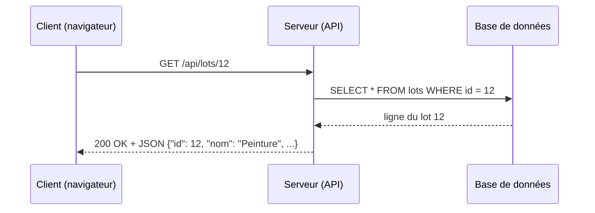
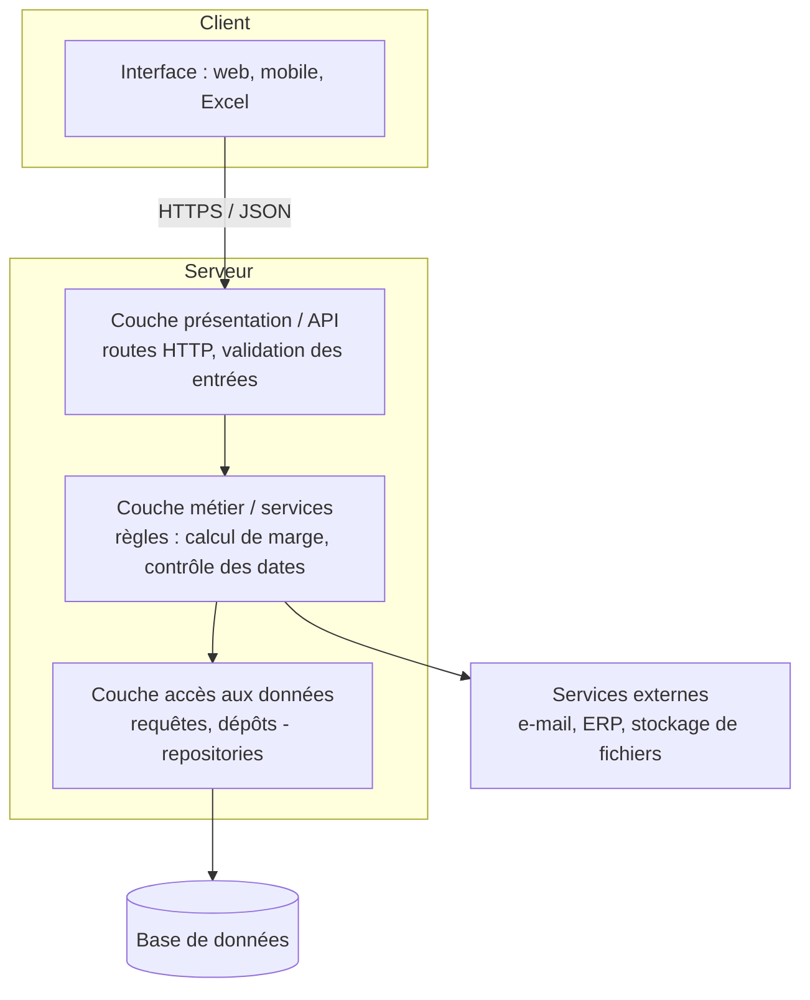
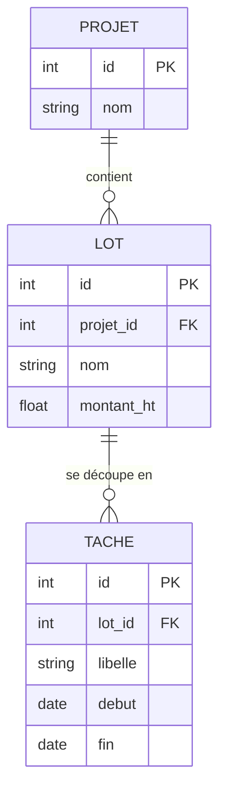

# 06 — Architecture logicielle

## Objectif

Comprendre comment s'organise une application au-delà d'un script : modèle client/serveur, architecture en couches, API REST, base de données. Savoir lire (et dessiner) un schéma d'architecture pour dialoguer avec une équipe de développement.

## Prérequis

- [02 — Python premiers pas](02-python-premiers-pas.md) et [03 — Bonnes pratiques](03-bonnes-pratiques-code.md).
- Avoir déjà utilisé un site web (c'est tout).

## Client / serveur

- Le **client** demande : navigateur, application mobile, script Python, Excel avec Power Query...
- Le **serveur** répond : il détient la logique et les données, et sert plusieurs clients à la fois.
- Ils communiquent par le réseau, le plus souvent en **HTTP(S)** avec des données au format **JSON**.



## Architecture en couches

On sépare le code en couches qui ne parlent qu'à leurs voisines. Chacune peut être modifiée ou testée sans toucher aux autres.



| Couche | Rôle | Ne doit pas... |
|--------|------|----------------|
| Présentation / API | recevoir la requête, valider, renvoyer la réponse | contenir des règles métier |
| Métier (services) | appliquer les règles de gestion | connaître HTTP ou le SQL |
| Accès aux données | lire / écrire dans la base | décider des règles |

Bénéfice concret : la règle « une tâche ne peut pas finir avant de commencer » est écrite **une seule fois**, dans la couche métier, et s'applique que la donnée vienne du site web, d'un import Excel ou d'une autre API.

## API REST

Une API REST expose des **ressources** (lots, tâches, utilisateurs) via des URL, et utilise les **verbes HTTP** pour les actions.

| Verbe | URL | Action | Code de succès |
|-------|-----|--------|----------------|
| `GET` | `/api/lots` | lister les lots | 200 OK |
| `GET` | `/api/lots/12` | lire le lot 12 | 200 OK |
| `POST` | `/api/lots` | créer un lot | 201 Created |
| `PUT` / `PATCH` | `/api/lots/12` | remplacer / modifier partiellement | 200 OK |
| `DELETE` | `/api/lots/12` | supprimer | 204 No Content |

Codes d'erreur à connaître : **400** requête invalide, **401** non authentifié, **403** interdit, **404** introuvable, **409** conflit, **500** erreur du serveur.

Bonnes pratiques : des **noms** au pluriel dans les URL (`/lots`, pas `/getLots`), filtres en paramètres (`/api/lots?statut=en_retard`), versionner l'API (`/api/v1/...`), pagination pour les grandes listes, **HTTPS** et authentification (jeton) obligatoires.

Appeler une API depuis Python (bibliothèque `requests`, à installer) :

```python
import requests

reponse = requests.get("https://api.exemple.com/v1/lots", params={"statut": "en_retard"}, timeout=10)
reponse.raise_for_status()          # lève une erreur si code 4xx / 5xx
for lot in reponse.json():
    print(lot["nom"])
```

Exposer une petite API avec **FastAPI** (`pip install fastapi uvicorn`) :

```python
# api.py
from fastapi import FastAPI, HTTPException
from pydantic import BaseModel

app = FastAPI()
LOTS = {1: {"id": 1, "nom": "Gros oeuvre", "montant_ht": 120000}}


class NouveauLot(BaseModel):
    nom: str
    montant_ht: float


@app.get("/api/lots/{lot_id}")
def lire_lot(lot_id: int):
    if lot_id not in LOTS:
        raise HTTPException(status_code=404, detail="Lot introuvable")
    return LOTS[lot_id]


@app.post("/api/lots", status_code=201)
def creer_lot(lot: NouveauLot):
    nouvel_id = max(LOTS) + 1
    LOTS[nouvel_id] = {"id": nouvel_id, **lot.model_dump()}
    return LOTS[nouvel_id]
```

Lancement : `uvicorn api:app --reload`, puis ouvrez http://127.0.0.1:8000/docs (documentation interactive générée automatiquement).

## Base de données

| Type | Exemples | Points forts | Usage typique |
|------|----------|--------------|---------------|
| Relationnelle (SQL) | PostgreSQL, SQLite, SQL Server, MySQL | tables liées, intégrité, transactions, requêtes riches | données de gestion structurées |
| Document (NoSQL) | MongoDB | schéma souple (JSON) | données hétérogènes |
| Clé-valeur | Redis | très rapide | cache, sessions |
| Séries temporelles | InfluxDB, TimescaleDB | mesures horodatées | capteurs, supervision |

Dans une base relationnelle, les données sont réparties dans des **tables** reliées par des **clés** :



Exemple avec SQLite, inclus dans Python (aucune installation) :

```python
import sqlite3

con = sqlite3.connect(":memory:")   # base en mémoire ; mettez "chantier.db" pour un fichier
con.execute("CREATE TABLE lot (id INTEGER PRIMARY KEY, nom TEXT NOT NULL, montant_ht REAL)")
con.executemany("INSERT INTO lot (nom, montant_ht) VALUES (?, ?)",
                [("Gros oeuvre", 120000), ("Electricite", 45000), ("Peinture", 12000)])
con.commit()

seuil = 20000
for nom, montant in con.execute(
        "SELECT nom, montant_ht FROM lot WHERE montant_ht > ? ORDER BY montant_ht DESC", (seuil,)):
    print(nom, montant)
# Gros oeuvre 120000.0
# Electricite 45000.0
con.close()
```

Les `?` sont des **paramètres** : ne construisez jamais une requête SQL en collant des chaînes (`f"... WHERE nom = '{saisie}'"`), c'est la porte ouverte à l'**injection SQL**.

## Monolithe ou microservices ?

| | Monolithe (une seule application) | Microservices (plusieurs petites applications) |
|---|---|---|
| Démarrage | simple | complexe |
| Déploiement | tout ensemble | chaque service indépendamment |
| Équipe adaptée | petite / moyenne | plusieurs équipes autonomes |
| Risques | grossit et s'emmêle si mal découpé | réseau, cohérence des données, supervision |

Pour la grande majorité des projets internes : **un monolithe bien découpé en couches et en modules**. On extrait un service quand un besoin réel l'impose (charge, équipe, cycle de vie différent).

## Lire un schéma d'architecture : questions à poser

- Qui sont les **utilisateurs** et les **clients** (web, mobile, autres systèmes) ?
- Où sont **stockées** les données, qui en est responsable, comment sont-elles **sauvegardées** ?
- Comment se fait l'**authentification** ? Les échanges sont-ils chiffrés (HTTPS) ?
- Que se passe-t-il si un composant **tombe** (base, service externe) ?
- Comment **déploie-t-on** une nouvelle version, et comment revient-on en arrière ?
- Où sont les **journaux** (logs) et la supervision ?

## Pièges courants

- **Règles métier dans l'interface** ou dans les requêtes SQL : elles se dupliquent et divergent.
- **Excel comme base de données partagée** : pas d'accès concurrent fiable, pas d'intégrité. Au-delà de quelques utilisateurs, passez à une vraie base.
- **Secrets dans le code** (mot de passe de base, clé d'API) : utilisez des variables d'environnement ou un coffre-fort de secrets.
- **Microservices trop tôt** : complexité sans bénéfice.
- **API sans gestion d'erreurs ni délai** (`timeout`) : un service lent bloque tout.
- **Pas de sauvegarde testée** : une sauvegarde qu'on n'a jamais restaurée n'est pas une sauvegarde.

## Pour aller plus loin

- Modèle **C4** (contexte, conteneurs, composants, code) pour dessiner l'architecture à plusieurs niveaux de zoom.
- *Architecture Decision Records* (ADR) pour tracer les choix.
- SQL : tutoriel SQLite, puis PostgreSQL ; ORM Python **SQLAlchemy**.
- Sécurité web : OWASP Top 10.
- Déploiement : conteneurs Docker, intégration et déploiement continus (CI/CD).
